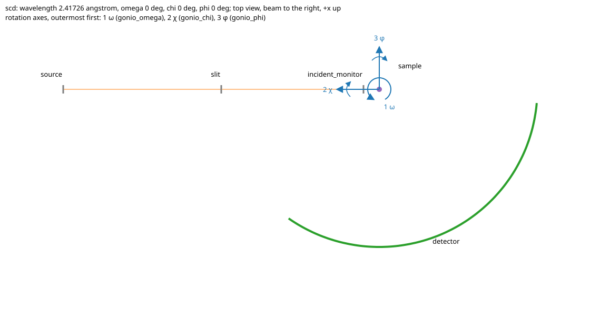
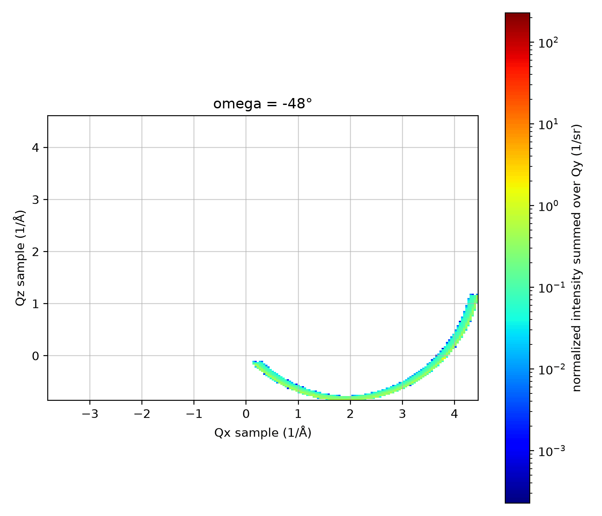

# mcstas_to_sqe

[](https://github.com/bingli621/mcstas_to_sqe/actions/workflows/ci.yml)

Neutron instruments described as components, built and simulated in McStas (McStasScript), with
tools to read the McStas NeXus output (McStasToX, scippneutron) and convert it to momentum transfer.
It comes with a single-crystal diffractometer with a three-axis goniometer, and ready-made samples.

The diffractometer seen from above (`d.plot_top_view("output/top_view.svg")`): the goniometer axes
numbered outermost first, each with the way a positive angle turns it.



An omega scan over 132 points of La2Ni7, in momentum transfer, normalized
(`scripts/plot_scan_Q.py`):



## Layout

```
src/mcstas_to_sqe/   the library (installed)
  core/             the entities any instrument shares: an instrument is a set of components (no
                    files, no McStas)
    components/       the components, one dataclass each, named after the McStas component
                      (base.py: Component; misc.py: Progress_bar, Slit, Arm;
                       source.py: Source_simple; detector.py: Monitor, Monitor_nD;
                       crystal.py: Single_crystal)
    base.py           Instrument: the base of any instrument (components, params, instr_params,
                      positions); INSTRUMENTS, every one by class name. io/ and the McStas builder
                      work with any
    params.py         param: a control parameter with its unit and comment; InstrParam: one
                      McStas instrument parameter (any instrument)
    geometry.py       rotation, place_absolute: the components' positions in the lab frame, as McStas places them
    utils.py          evaluate: a McStas expression of instrument parameters ("-chi"), safely;
                      format_value: a value short, for display
  instruments/      the instruments, one package each (importing it registers them in INSTRUMENTS)
    diffractometer/   SingleCrystalDiffractometer(sample, params), an Instrument: makes its own
                      components around the sample, each recording where it sits; its control
                      parameters Params, DEFAULT_PARAMS; instr_params: the wavelength of ei, and
                      the goniometer angles; params.yaml (PARAMS_FILE): its default saved, naming
                      the components in beam order; plot_top_view: its top view (plot/)
  samples/          the ready-made samples aluminum, la2ni7, for any instrument (in __init__.py,
                    which says how to add one), with their CIF files (La2Ni7.cif)
  io/           files of the instrument (an adapter around the entities)
    dict_io.py        to_dict, from_dict: any instrument to and from its nested dict; from_overrides:
                      the default instrument with only what differs laid over it; merge
    yaml_io.py        the only module that knows YAML: load(path, **kwargs), save(instrument,
                      path); read_yaml, write_yaml
  mcstas/       everything that talks to McStas
    builder.py        builds the McStasScript instrument of any instrument: places each component,
                      sets its McStas parameters (each component's mcstas_parameters)
    simulation.py     Simulation(instrument): run, scan, run_to_sample, run_from_sample,
                      scan_from_sample
    nexus_io.py       read_scan: the NeXus output via mcstastox; merge_entries: single runs
                      into one scan file
    run_folders.py    the run folders: default_output_dir, run_folder (by time and mode, or a
                      safe folder_name), list_runs, latest_run, latest_beam, monitor_file, clean_runs
  plot/         pictures of any instrument (an adapter around the entities)
    top_view.py       top_view_svg(instrument, path): seen from above, its rotation axes (from
                      the components' `rotated`) numbered outermost first with the way each turns;
                      rotation_axes; SHAPES: how each type of component is drawn
  reduction/    to_Q, to_sample_frame, solid-angle normalization, find_peaks
scripts/        work_dir.py (their folders), build_instrument.py, run_mcstas.py, plot_scan_2d.py, plot_scan_Q.py (gifs), print_peaks.py
tests/
mcstas_input/   generated McStas files, a folder per instrument: .instr, .c, binary (git-ignored)
mcstas_output/  simulation results (git-ignored)
output/         figures and peak lists made from the results
```

Dependencies point inwards (clean architecture): `core` holds the entities any instrument
shares and imports nothing from the outer layers; `instruments` (each instrument) and `samples` (the
ready-made samples, placed by the caller with `relative`) build on it. Around it are adapters: `io` converts any instrument
to and from its nested dict and YAML files, `mcstas` builds and simulates
any instrument that the caller creates, `plot` draws any instrument, and `reduction` reads the McStas output with `mcstas.nexus_io`.

## Configuration

The diffractometer makes itself in code, `SingleCrystalDiffractometer()` (`instruments/diffractometer/`): the
components in the order of the beam, with their values. Its components are plain attributes
(`d.slit.xwidth = 0.02`); what follows from them (their positions in the lab frame, the sample's
reciprocal vectors) is computed when used. `print(d)` shows a summary (the params, the instrument
parameters, and a table of the components: where each sits and its position); `print(d.source)` shows
one component's values.

A parameters file names its instrument and is laid over that one's default with
`load(path, sample=..., params=...)` (`io/yaml_io.py`), so it need hold only what differs: a value it gives wins, one it
leaves out, or sets to `null`, stays as made. Its layout is that of
`src/mcstas_to_sqe/instruments/diffractometer/params.yaml` (`PARAMS_FILE`), the default diffractometer saved (a test keeps them equal): `instrument`, the class
(`SingleCrystalDiffractometer`; every file names it), `params` (see below) and one
section per component name: its `component` (the McStas component),
its parameters, where it sits (`at`, `rotated`, `relative`), and last its `position` in the lab
frame (m; calculated with the diffractometer's angles, written for reading and never read back:
`d.positions()` gives them). Save your own with
`save(d, "copy.yaml")`, edit it, and load it with `load("copy.yaml")`.

The parameters are one nested dict (`io/dict_io.py`). The source aims at the component it focuses on
(`focus_on`): the McStas builder sets its focus distance to that one's. Components never see the
file.

The sample (a `Single_crystal`, or None) and the params, the incident energy `ei` (meV) and the
goniometer angles `omega`, `chi`, `phi` (deg), are given when the instrument is made,
`SingleCrystalDiffractometer(sample, Params(ei=14, omega=0))`; by default 14 meV and all angles 0.
`Params` is a frozen dataclass: `d.params.ei` reads one, `d.params.ei = 25` raises, and
`d.update_params(ei=25)` changes them (an unknown name raises). The file holds them in its `params`
section, each with its unit and comment (`ei: {value: 14.0, unit: meV, comment: incident energy}`);
a unit, if given, must be the one in the code, and a bare number is the value (`ei: 25`).

The instrument parameters (`d.instr_params`, a list of `InstrParam`) are what McStas gets, calculated
from the params when used (never saved): the wavelength of `ei` (`Source_simple.wavelength_from_ei`; the source's
`lambda0` names it), and the goniometer angles. Where a component takes a number it names an
instrument parameter instead (or an expression of them), as in McStas: the goniometer arms have
`rotated: [0, omega, 0]` etc. A run may give its own values in place of the diffractometer's
(`Simulation(d).run(omega=30)`).

Every McStas run records its wavelength and angles, and the
reduction reads them from the scan (`find_peaks(folder)`); give `find_peaks(folder, wavelength(14))`
for older scans that do not store it.

```yaml
# my_params.yaml: the instrument, and only what differs from its default, for example
instrument: SingleCrystalDiffractometer
source:
  radius: 0.02
detector:
  radius: 0.8
slit:
  at: [0, 0, 1.2]
```

```python
import numpy as np

from mcstas_to_sqe.mcstas.nexus_io import read_scan
from mcstas_to_sqe.mcstas.simulation import Simulation
from mcstas_to_sqe.instruments import Params, SingleCrystalDiffractometer
from mcstas_to_sqe.io import load

# the diffractometer to simulate, the default one with the file laid over it
sim = Simulation(load("my_params.yaml", params=Params(ei=14)))
h5 = sim.scan("omega", np.linspace(-48, 73, 122), chi=0, phi=0)  # a run per omega

# a sample (none by default)
from mcstas_to_sqe.samples import la2ni7

sim = Simulation(
    SingleCrystalDiffractometer(
        la2ni7(mosaic=60, at=[0, 0, 0], relative="gonio_phi"), Params(ei=14)
    )
)
h5 = sim.scan("omega", np.linspace(-48, 73, 122), chi=-5.893, phi=0)
points = read_scan(h5.parent)  # a (parameters, events) per scan point

# a split run: the beam once, then the crystal for one omega, or many in parallel
sim.run_to_sample(ncount=1e8)
sim.run_from_sample(omega=30, chi=-5.893, phi=0)
sim.scan_from_sample("omega", range(-48, 83), chi=-5.893, phi=0)
```

A diffractometer can be created in these ways:

```python
from mcstas_to_sqe.instruments import Params, SingleCrystalDiffractometer
from mcstas_to_sqe.io import from_dict, load, save, to_dict, read_yaml
from mcstas_to_sqe.samples import la2ni7

# the default one, made in code (instruments/diffractometer/)
d = SingleCrystalDiffractometer()
d = SingleCrystalDiffractometer(la2ni7(at=[0, 0, 0], relative="gonio_phi"), Params(ei=14))
# with a file laid over it (read with a loader: YAML by default)
d = load("my_params.yaml")
d = load("my_params.yaml", params=Params(ei=14), loader=read_yaml)
# from a complete dict
d = from_dict(to_dict(d))
# change it
d.slit.xwidth = 0.02
# save its parameters (a complete file: load gives it back)
save(d, "copy.yaml")
```

## Use

```bash
pixi run python scripts/build_instrument.py             # the .instr file, its diagram
pixi run python scripts/run_mcstas.py                   # simulate it; edit MODE: a run, a scan, or beam dump + scan from the beam
pixi run python scripts/plot_scan_2d.py                 # output/scan.gif
pixi run python scripts/plot_scan_Q.py                  # output/scan_Q.gif
pixi run python scripts/print_peaks.py                  # peak list of the newest scan
pixi run python -c "from mcstas_to_sqe.instruments import SingleCrystalDiffractometer as D; D().plot_top_view('output/top_view.svg')"
pixi run pytest --cov=mcstas_to_sqe --cov-report=term-missing   # tests + coverage
pixi run pre-commit install                             # once: ruff format on every commit
```

McStas builds in `mcstas_input/<instrument name>/` and results go to `mcstas_output/`, a folder
per run named by its start time and mode (`20261022-143005_scan_omega/`, `..._run_to_sample/`,
`..._scan_omega_from_sample/`; `folder_name="..."` picks a fixed one instead, replaced on each run), and the
figures and peak lists to `output/`, all in the work folder, so they are there to look at. For the library that
is the current folder (`default_work_dir()`; `default_figures_dir()` for `output/`); the scripts always use the
repository, wherever they run from (`scripts/work_dir.py`: an Interactive Window starts in `scripts/`).
`list_runs()` lists the runs, newest first, `latest_run(pattern="*_scan_omega")` finds the
newest one and `clean_runs(keep=5)` removes all but the newest five (never a `run_to_sample` run: delete those by hand), all in `mcstas.run_folders`. `Simulation(d, work_dir=...)` or the environment variable
`MCSTAS_TO_SQE_WORKDIR` moves all three, for the library and the scripts, and `Simulation(d, output_dir=..., input_dir=...)` either. A split run
simulates source to sample once (`Simulation.run_to_sample`) and then the crystal for one angle (`run_from_sample`) or many in
parallel (`scan_from_sample`), which can be normalized with the beam run's incident monitor.

`mcstastox` is installed from the `entry_choice` branch, which can read individual scan entries.
